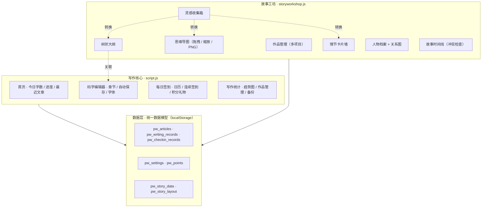

# 我的小小世界 · 个人写作空间

一款轻量的个人写作与创作管理网页应用。无需安装依赖或启动服务器，用浏览器打开 `index.html` 即可开始写作，字句只留在本地。

> 从「记录日常」到「构思长篇」，一个页面装下完整的写作旅程。

当前代码的功能更新摘要见 [CHANGELOG.md](./CHANGELOG.md)。

## 功能

### 写作与记录
- **富文本写作编辑器**：创建、搜索、重命名和删除文章；支持在正文中编辑并局部设置粗体、斜体、下划线、字体和字号。
- **章节管理**：把长篇作品拆分成章节，按章节分别编辑，支持多章节连续创作。
- **自动保存**：编辑内容自动保存到浏览器本地存储，支持手动保存（`Ctrl/Cmd + S`）、离开前保存与定时兜底保存。
- **写作统计**：记录每日、本月与累计字数，近 7 天趋势折线图，可设置每日写作目标。
- **作品管理**：表格化查看与排序（按标题 / 创建时间 / 更新时间），支持导出单篇、跳转编辑与删除。

### 每日签到
- **签到日历**：支持月份切换，记录连续签到天数与本月签到次数。
- **积分奖励**：签到获得积分，连续签到额外奖励；可兑换内置奖励，也可自定义礼物名称、图标、积分价格和兑换文案，并进行管理。

### 故事工坊
面向构思与长篇创作的完整创作台，多个项目分门别类管理：

- **灵感收集箱**：快速记录灵感，支持分类、标签、搜索与状态筛选，可一键「转情节 / 转大纲 / 转导图 / 关联情节」。
- **思维导图**：可视化梳理设定与结构，支持节点拖拽、缩放、平移、折叠，并可导出 PNG 图片。
- **树状大纲**：按「幕 / 章 / 场景 / 节拍」分层组织，支持排序、复制子树，并能关联正文文章、情节与人物。
- **情节卡片墙**：用「起因 → 行动 → 结果 → 余波」整理情节因果，支持按状态或章节分组。
- **人物档案与关系图**：管理人物设定，自动绘制人物关系图，可增删改人物关系。
- **故事时间线**：按故事时间排序事件、标记不确定事件，并自动做时间线冲突检查。

### 数据与备份
- 支持单篇 TXT 导出、单个作品 JSON 导出，以及全站数据（文章 + 故事工坊 + 签到 + 积分 + 设置）一键 JSON 备份与恢复。

## 项目特点

- **零依赖、纯静态**：原生 HTML / CSS / JavaScript 实现，不依赖任何框架、构建工具、数据库或后端服务，下载即可用。
- **隐私优先、数据本地化**：所有内容仅保存在浏览器的 `localStorage` 中，不上传服务器、不跨设备同步，你的创作只属于你自己。
- **完整的创作闭环**：从「灵感 → 大纲 / 导图 → 情节 → 人物 → 时间线」到「码字 → 签到 → 统计 → 作品管理」，覆盖写作的全过程。
- **统一数据模型、跨模块联动**：灵感、大纲、情节、人物、时间线共享同一套数据，修改一处、多处联动，避免重复录入。
- **多重自动保存、不易丢稿**：定时自动保存 + 编辑器失焦/切换自动保存 + 手动快捷键 + 关闭页面前保存，多重兜底。
- **温暖的手账视觉风格**：暖纸底色、衬线字体、宽松留白，营造安静、专注的书写氛围；同时支持桌面与移动端响应式布局。
- **代码简洁、易读懂、易扩展**：使用易理解的函数式风格与清晰的模块划分（核心逻辑 `script.js` + 故事工坊 `storyworkshop.js`），适合编程初学者阅读、学习与二次开发。

## 功能架构

## 开始使用

1. 下载或克隆本仓库。
2. 在浏览器中打开 `index.html`。
3. 进入「码字」页面新建文章即可开始写作。
4. 若要构思长篇，进入「工坊」新建作品，开始整理灵感、大纲与人物。

本项目为纯静态网页，不需要 Node.js、数据库或其他依赖。

## 数据与备份

文章、写作记录、签到、积分和设置保存在浏览器的 `localStorage` 中，不会自动上传到服务器，也不会在不同设备或浏览器之间同步。清理浏览器站点数据可能会删除这些内容，建议定期在「统计」页面使用「导出全部备份」保存 JSON 文件；需要恢复时使用「导入备份」。

## 项目文件

- `index.html`：页面结构
- `style.css`：页面样式与响应式布局
- `script.js`：编辑器、统计、签到、礼物及本地数据逻辑
- `storyworkshop.js`：故事工坊模块（灵感 / 导图 / 大纲 / 情节 / 人物 / 时间线）